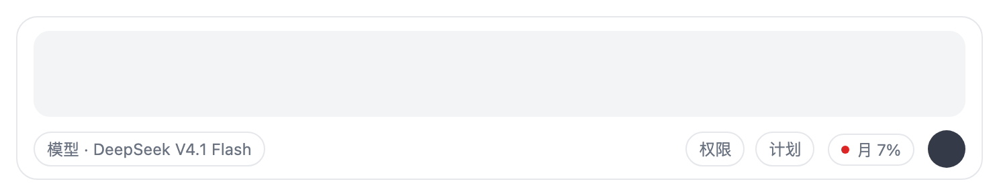
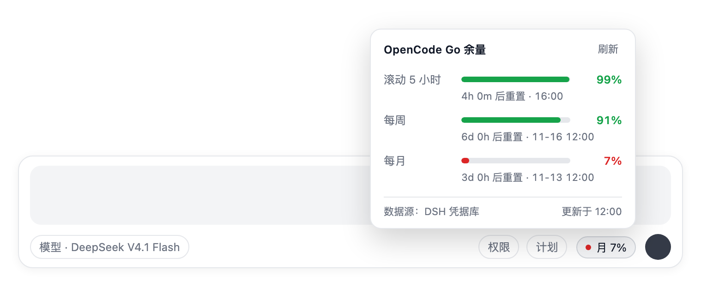
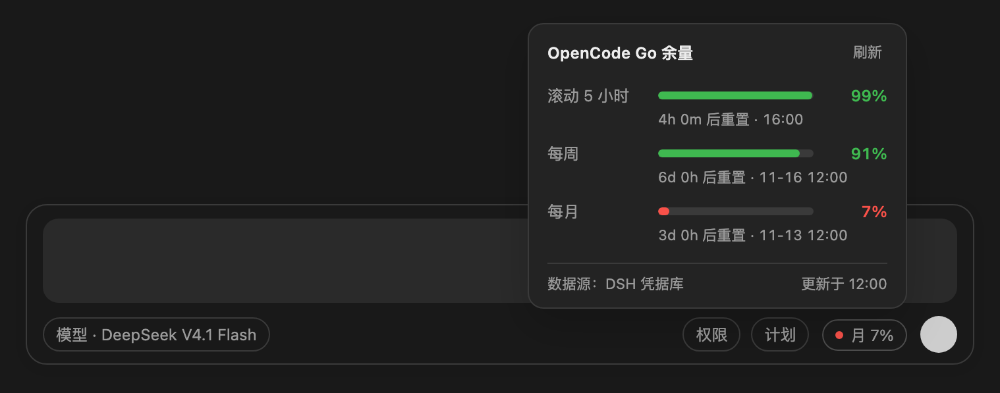
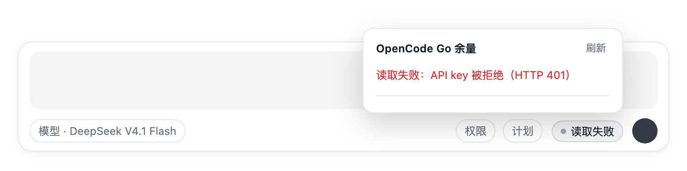
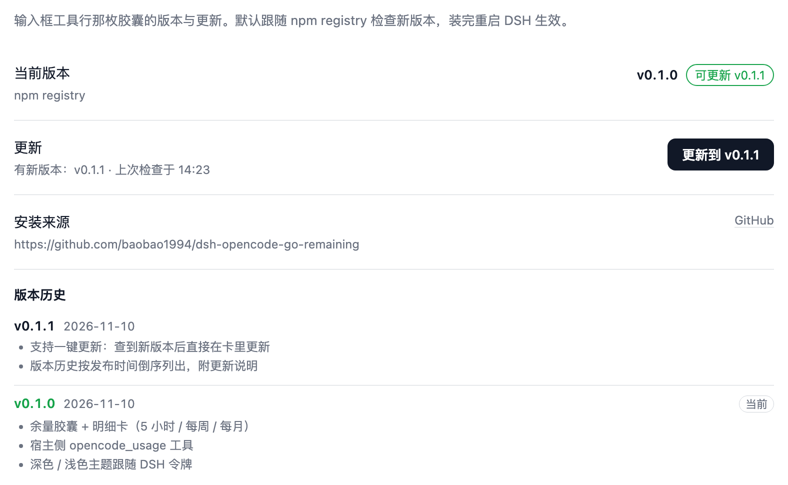

<p align="center">
  
</p>

# dsh-opencode-go-remaining

[](https://www.npmjs.com/package/dsh-opencode-go-remaining)
[](LICENSE)
[](https://nodejs.org)
[](https://github.com/baobao1994)

OpenCode Go 余量插件（DSH / DeepSeek Harness Web UI）。

在输入框工具行常驻一枚胶囊，显示**最紧张那一档**的剩余百分比；点开是明细卡：滚动 5 小时、
每周、每月三档的剩余量进度条、重置倒计时与重置时刻、刷新按钮和数据来源。

同时注册 `opencode_usage` 工具，问 agent「opencode 还剩多少」时它会直接调官方接口回答。

## 截图

| 输入框工具行的胶囊 | 明细卡（浅色） |
|---|---|
|  |  |
| **明细卡（深色）** | **读取失败时的降级** |
|  |  |

> 截图由同一份 `client.js` 在独立 Chromium 里渲染（真实 React 18 + 同样的 slot 注册），
> 配色取自 DSH 的 `--dsw-alias-*` 令牌，因此深浅色主题都与宿主一致。

## 版本与更新

版本与更新在**设置 → 插件 → OpenCode Go 余量**这个标签页里（Plugins 页本身是 DSH 内置的
插件入口，我们往它里面挂一个自己的标签页）：



> 截图里的 `v0.1.1` 是示意用的示例数据。

- **检查更新**：宿主按安装来源去问对应的 registry（默认 npm 官方源，插件管理器配了镜像就跟着走），
  8 秒超时、结果缓存 10 分钟；胶囊的悬浮提示也会带上「可更新 vX.Y.Z」。
- **更新**：标签页里点「更新到 vX.Y.Z」，走 DSH 插件管理器的 `installBundle` 直接重装，
  装完提示「已更新到 vX.Y.Z，重启 DSH 生效」。
- **版本历史**：按发布时间倒序列出已发布版本，每条附 `CHANGELOG.md` 里的更新说明，
  当前版本打「当前」标签；registry 连不上时退化为只读本地 `CHANGELOG.md`，不会空白。
- **明细卡只留一句提醒**：查到新版本时卡片底部多一行「可更新 v0.1.1 · 设置 → 插件 里更新」，
  平时不占位置。
- **本地安装不提示更新**：`link:` / 文件夹安装显示「本地安装（git pull 更新）」——
  这种安装的更新源是那个目录，不是 registry。

## 颜色与刷新

胶囊只报**最紧张那一档**，按剩余量着色：

| 剩余量 | 颜色 | 含义 |
|---|---|---|
| ≥ 50% | 绿 | 充足 |
| 20% – 49% | 黄 | 偏紧 |
| < 20% | 红 | 告急 |

- 页面可见时每 60 秒刷新一次；点开明细卡会强制刷新（绕过宿主 15 秒缓存）。
- 刷新失败时胶囊保留上次数据并显示「读取失败」，明细卡顶部给出错误原因。
- 点击卡外区域或按 `Escape` 关闭。

## 数据来源

```
GET https://opencode.ai/zen/go/v1/usage
Authorization: Bearer <OPENCODE_GO_API_KEY>
→ {"usage":{"rolling":{"percent":0,"resetsAt":"..."},"weekly":{...},"monthly":{...}}}
```

`percent` 是**已用**百分比，插件显示的是 `100 - percent`（剩余）。

## API key 解析顺序

1. 插件配置里的 `apiKey`（`cordis.patch.yml` 的 `config`）
2. DSH 凭据库：`ctx.credentials.resolve('OPENCODE_GO_API_KEY')` —— `opencode-go` 模型 provider 用的就是它，所以通常**零配置**
3. `$DSH_HOME/.credentials.yaml` 的 `refs:` 段
4. 环境变量 `OPENCODE_GO_API_KEY` / `OPENCODE_API_KEY`
5. opencode 自己的认证文件：`~/.local/share/opencode/auth.json` 的 `opencode-go` 条目

## 安装

从 npm 装：

```bash
dsh plugin --profile web add dsh-opencode-go-remaining
```

本地开发时，在 DSH 里用 `plugin_manager` 的 `install_bundle`，`target` 填本目录绝对路径。

安装后无需重启：宿主半侧注册 `/api/opencode-go-remaining/usage`、`/update`、`/versions` 三条路由与工具，
浏览器半侧注册 `conversation.input.right`（胶囊）与 `shell.overlay`（明细卡）两个 slot。

## 配置

在 `~/.dsh/profiles/<profile>/cordis.patch.yml` 里覆盖本插件的 `config`：

| 字段 | 默认 | 说明 |
|---|---|---|
| `apiKey` | 空 | 直接写 key（不推荐，优先用凭据库） |
| `apiKeyId` | `opencode-go` | opencode 认证文件里的条目 id |
| `authFile` | `~/.local/share/opencode/auth.json` | opencode 认证文件路径 |
| `baseURL` | `https://opencode.ai/zen/go/v1/usage` | 接口地址覆盖 |
| `timeoutMs` | `15000` | 单次请求超时 |

## 结构

| 文件 | 作用 |
|---|---|
| `index.js` | 宿主半侧：key 解析、用量抓取与缓存、loopback 路由、`opencode_usage` 工具 |
| `client.js` | 浏览器半侧：胶囊 + 明细卡（React，无 DOM 劫持） |
| `update.js` | 版本检查、registry 查询、版本历史与一键更新（走插件管理器的 `installBundle`） |
| `cordis.patch.yml` | bundle 补丁，插入一行宿主插件 |
| `CHANGELOG.md` | 更新日志；卡里的版本历史直接读它 |
| `locale/{en,zh}.json` | 插件管理页的标题与描述 |
| `icon.svg` | 插件图标 |
| `docs/img/` | README 用的图标与截图（`icon.png` 由 `icon.svg` 渲染） |

## License

MIT
